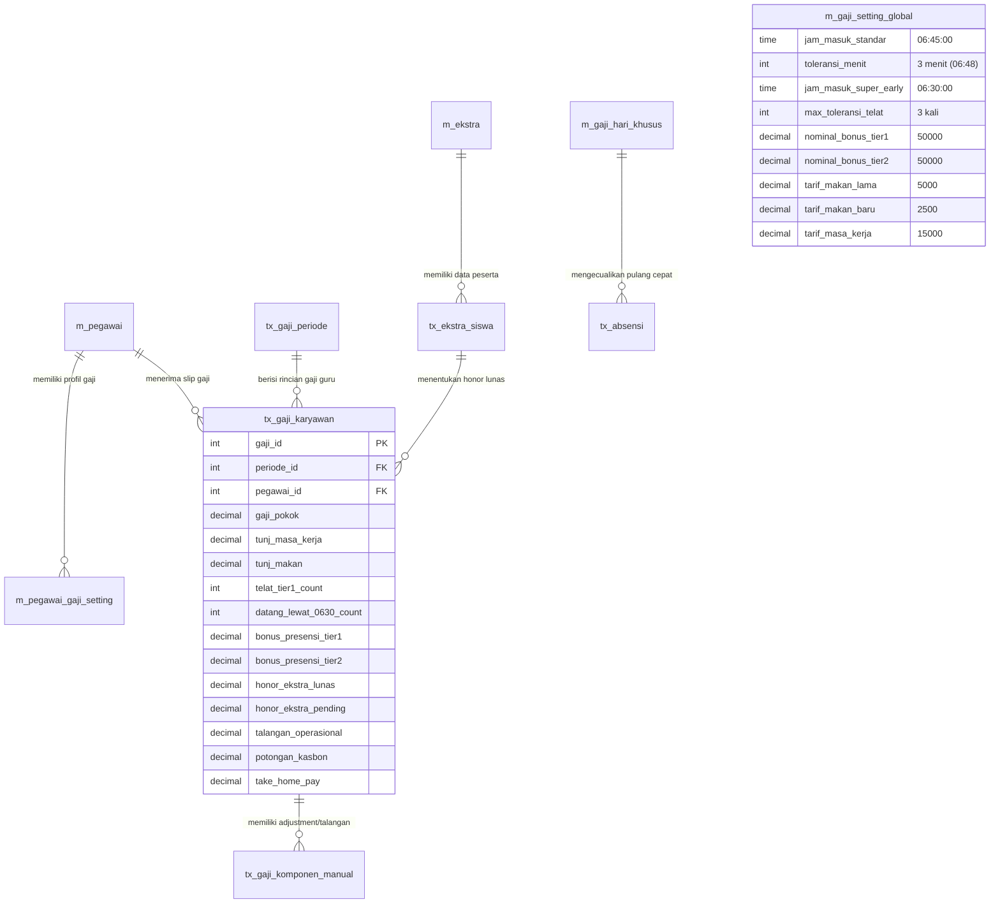

# 📄 PRODUCT REQUIREMENT DOCUMENT (PRD) - v2.0
## SISTEM PENGGAJIAN & MUKAFAAH GURU/KARYAWAN TERINTEGRASI PRESENSI BIOMETRIK
### SD MENTARI ISLAMIC SCHOOL (SDMIS)
*Disesuaikan secara presisi berdasarkan 12 Alur Standar Operasional Prosedur (SOP) Penggajian Mentari dari Manajemen Yayasan*

---

| Informasi Dokumen | Detail |
| :--- | :--- |
| **Nama Proyek** | Modul Penggajian & Mukafaah Terintegrasi Presensi & Pelunasan Ekstra |
| **Instansi** | SD Mentari Islamic School (SDMIS) |
| **Aplikasi Target** | Portal Web Admin SDMIS (`https://sdmis.sch.id`) |
| **Sifat Akses** | **Internal & 100% Rahasia (Confidential)** - Tersembunyi penuh dari webapp guru (`https://presensi.sdmis.sch.id`) |
| **Role Pengguna** | Superadmin (Role ID 1) & Bendahara / Keuangan Yayasan |
| **Versi Dokumen** | **v2.0 - Spesifikasi Lengkap Berdasarkan SOP Nyata Klien** |
| **Tanggal Pembaruan**| 25 November 2026 |

---

## 1. LATAR BELAKANG & ANALISIS 12 SOP ALUR PENGGAJIAN MENTARI

Berdasarkan dokumen konfirmasi alur kerja operasional langsung dari manajemen SD Mentari Islamic School:

```
                  SOP 12 ALUR PENGGAJIAN SD MENTARI ISLAMIC SCHOOL
┌───────────────────────────────────────────────────────────────────────────────────┐
│ 1. Akses Portal Admin paling lambat tanggal 8 setiap bulan                        │
│ 2. Tarik & evaluasi presensi tanggal 1 - 30/31 bulan lalu                         │
│ 3. Pengecekan kehadiran per guru:                                                 │
│    a. Verifikasi pengecualian hari khusus pulang lebih awal (bukan pelanggaran)   │
│    b. Cek setting rentang cut-off tanggal 1 - 30/31                               │
│    c. Cek jam masuk 06.45 (toleransi 3 menit -> batas 06.48 WIB)                  │
│    d. Cek jam masuk 06.30 (kategori super early / hadir pagi)                     │
│    e. Poin c: Keterlambatan (> 06.48) <= 3 kali -> Bonus Rp 50.000                │
│    f. Poin d: Kedatangan (> 06.30) <= 3 kali -> BONUS TAMBAHAN Rp 50.000          │
│ 4. Generate otomatis bonus presensi (Tier 1 & Tier 2) ke setiap guru              │
│ 5. Input talangan operasional / kasbon (Pak Anwar, Pak Nuki, Bunda Dewi, dll)    │
│ 6. Validasi status pembayaran administrasi ekstrakurikuler siswa                  │
│ 7. Kalkulasi mukafaah guru ekstra sesuai siswa yang SUDAH LUNAS di awal bulan     │
│ 8. Siswa BELUM LUNAS -> Honor ekstra ditangguhkan (carry-over ke bulan depan)     │
│ 9. Konfirmasi kehadiran Tasmi' Tahfidz Kak Anas & Pak Rico                       │
│ 10. Rekonsiliasi & Cross-Check Rincian Komponen vs Total Tabel Mukafaah          │
│ 11. Sinkronisasi data ke format Payroll Bank (BRI / BSI CMS)                      │
│ 12. Final Check: Validasi keseimbangan (Balance Matching 100% Klop)               │
└───────────────────────────────────────────────────────────────────────────────────┘
```

---

## 2. FORMULA BISNIS & ATURAN SPESIFIK SISTEM

### 2.1 Logika Bertingkat (Two-Tier) Bonus Presensi Pagi
Sistem menerapkan **dua tingkat apresiasi kedisiplinan kehadiran**:

```
                       BAGAN KEPUTUSAN BONUS PRESENSI
                                
                    [ Jam Masuk Riil dari Kamera Biometrik ]
                                       │
                  ┌────────────────────┴────────────────────┐
                  ▼                                         ▼
         [ Evaluasi Tier 1 ]                       [ Evaluasi Tier 2 ]
    Patokan: 06.45 (+3 mnt = 06.48)                 Patokan: 06.30.00
                  │                                         │
     Telat (> 06.48) <= 3x ?                   Datang (> 06.30) <= 3x ?
         ┌────────┴────────┐                       ┌────────┴────────┐
        Ya                Tidak                   Ya                Tidak
         │                 │                       │                 │
         ▼                 ▼                       ▼                 ▼
   Dapat Rp 50.000       Rp 0 (Hangus)       Dapat +Rp 50.000      +Rp 0
         │                                         │
         └────────────────────┬────────────────────┘
                              ▼
           [ TOTAL BONUS PRESENSI: Rp 0 s/d Rp 100.000 ]
```

1. **Tier 1 (Bonus Hadir Tepat Waktu Standar - Rp 50.000,-)**:
   - Jam masuk kerja acuan: **06.45 WIB**.
   - Batas toleransi dispensasi: **3 menit** (Batas akhir keterlambatan: **06.48.00 WIB**).
   - Jika frekuensi datang $> 06.48$ dalam sebulan **$\le 3$ kali** $\to$ **Dapat Rp 50.000,-**.
   - Jika datang $> 06.48$ sebanyak $\ge 4$ kali $\to$ **Rp 0 (Hangus)**.
2. **Tier 2 (Bonus Kehadiran Awal / Super Early - Rp 50.000,- TAMBAHAN)**:
   - Jam masuk super early: **06.30.00 WIB**.
   - Jika kedatangan setelah $06.30$ dalam sebulan **tidak lebih dari 3 kali** (artinya hampir setiap hari guru sudah standby di sekolah sebelum 06.30) $\to$ **Mendapatkan TAMBAHAN Rp 50.000,-**.
   - Jika datang setelah $06.30$ sebanyak $\ge 4$ kali $\to$ Tambahan Rp 0 (tidak dapat tier 2).
3. **Maksimal Bonus Presensi Total**:
   - Guru yang selalu hadir sebelum 06.30 mendapatkan total **Rp 100.000,-** (Tier 1 Rp 50.000 + Tier 2 Rp 50.000).
   - Guru yang hadir antara 06.31 s/d 06.48 mendapatkan **Rp 50.000,-** (Tier 1 saja).
   - Guru yang sering datang lewat 06.48 ($> 3$ kali) mendapatkan **Rp 0,-**.

### 2.2 Pengecualian Hari Khusus Pulang Cepat (Special Early Leave Waiver)
- Di sekolah terdapat agenda khusus seperti Rapat Kerja, Pembagian Rapor, Ujian Semester, atau Pengajian Guru di mana kepulangan lebih awal telah disetujui pihak yayasan.
- Sistem menyediakan fitur **Master Hari Khusus**: Guru yang melakukan absen pulang mendahului jadwal pada hari yang ditandai sebagai hari khusus **tidak akan dicatat sebagai pelanggaran pulang cepat**.

### 2.3 Aturan Honor Ekstrakurikuler Berbasis Status Pelunasan Siswa
- **Siswa LUNAS**: Honor per siswa (contoh: Panahan Rp 45.000 per anak) langsung masuk ke mukafaah guru pengampu di bulan berjalan.
- **Siswa BELUM LUNAS**: Hak honor guru dari siswa tersebut **ditangguhkan (Pending/Carry-Over)** dan otomatis ditagihkan/dicairkan pada periode bulan berikutnya setelah siswa melunasi pembayaran administrasi ekstra.

### 2.4 Honor Sesi Tasmi' & Tahfidz Al-Qur'an (Kak Anas & Pak Rico)
- Fitur pencatatan sesi kehadiran Tasmi' Tahfidz yang dapat diverifikasi oleh koordinator (Pak Rico) dan dikonfirmasi kepada pengampu (Kak Anas), dengan nominal per kehadiran/sesi (misal: Rp 25.000 per pertemuan).

### 2.5 Talangan Operasional & Kasbon
- Mendukung pencatatan talangan pengeluaran darurat sekolah (seperti servis kendaraan jemputan, tambal ban pikap, pembelian perlengkapan KBM) serta cicilan kasbon yang dipotong langsung pada slip gaji.

---

## 3. ARSITEKTUR STRUKTUR MENU PADA PORTAL SDMIS (`https://sdmis.sch.id`)

Semua fitur ditempatkan di bawah menu induk baru **"Penggajian (Mukafaah)"** yang dilindungi sistem hak akses (hanya Superadmin & Bendahara):

```
Portal SDMIS (Admin Portal)
│
├── Dashboard
├── Karyawan
├── Presensi
│
└── 💰 Penggajian (Mukafaah) [MODUL BARU]
    │
    ├── 1. ⚙️ Pengaturan Komponen & Aturan Gaji (/gaji/setting)
    │      - Setting jam masuk standar (06.45) & toleransi (3 menit -> 06.48)
    │      - Setting jam hadir pagi super early (06.30)
    │      - Setting nominal bonus Tier 1 (Rp 50.000) & Tier 2 (Rp 50.000)
    │      - Setting tarif uang makan lama (>3 thn) & baru (<=3 thn)
    │      - Setting tarif masa kerja GTY (Rp 15.000/tahun)
    │      - Master Kalender Hari Khusus Pulang Cepat
    │
    ├── 2. 👥 Master Gaji & Rekening Pegawai (/gaji/karyawan)
    │      - Pemetaan gaji pokok default 21 guru/karyawan
    │      - Status kepegawaian (GTY, Kontrak, Guru Ekstra, Karyawan)
    │      - Tugas tambahan tetap (Wali Kelas, Waka, Kepala PAUD, PJ Sarpras)
    │      - Rekening bank: Bank (BRI/BSI), No Rekening, Atas Nama, Kantor Cabang
    │
    ├── 3. 🎯 Manajemen Ekstrakurikuler & Siswa (/gaji/ekstra)
    │      - Daftar cabang ekstra & guru pengampu (Panahan, Renang, Sepatu Roda, dll)
    │      - Tracking status pelunasan iuran ekstra per siswa (Lunas / Belum)
    │      - Otomatisasi Carry-Over honor siswa yang baru lunas di bulan berjalan
    │
    ├── 4. 📅 Periode & Hitung Gaji Otomatis (/gaji/periode)
    │      - Pembuatan periode bulanan (cut-off tgl 1 - 30/31 bulan lalu)
    │      - Tombol Sakti: ⚡ "HITUNG OTOMATIS DARI PRESENSI"
    │        * Evaluasi otomatis Tier 1 & Tier 2 presensi
    │        * Evaluasi uang makan x hari hadir
    │        * Evaluasi masa kerja x Rp 15.000
    │        * Tarik honor ekstra dari siswa lunas
    │      - Tabel preview hasil perhitungan 21 guru
    │      - Tombol Penyesuaian Manual (Input talangan operasional, kasbon, transport)
    │      - Fitur Kunci & Finalisasi Penggajian
    │
    ├── 5. ⚖️ Rekonsiliasi & Balance Matching (/gaji/rekonsiliasi)
    │      - Verifikasi otomatis: Total Rincian Guru == Total Tabel Mukafaah == Total Payroll Bank
    │      - Deteksi selisih nominal (Rp 0 selisih = Indikator Hijau Siap Cair)
    │
    ├── 6. 📄 Rekapitulasi & Cetak Slip Gaji (/gaji/laporan)
    │      - Cetak Slip Gaji resmi perorangan format A5 (PDF & Print Friendly)
    │      - Cetak Rekapitulasi Pembukuan Mukafaah Bulanan Yayasan
    │
    └── 7. 💳 Export Mutasi Bank Payroll (/gaji/export_bank)
           - 1-Click Download Mutasi Bank BRI CMS (CSV)
           - 1-Click Download Mutasi Bank BSI CMS (Excel)
           - Format kolom 100% sesuai template perbankan
```

---

## 4. SKEMA DATABASE TERBARU (MODULAR & AMAN)



### 4.1 Tabel Baru yang Ditambahkan:
1. `m_gaji_setting_global`: Parameter acuan bertingkat 06.45 (+3 mnt) dan 06.30, nominal bonus, tarif makan, tarif masa kerja.
2. `m_gaji_hari_khusus`: Menyimpan tanggal hari khusus yang memperbolehkan kepulangan lebih awal.
3. `m_pegawai_gaji_setting`: Profil gaji pokok, status GTY, rekening bank per pegawai.
4. `m_ekstra`: Master ekstrakurikuler (Panahan, Renang, Sepatu Roda, Tahfidz).
5. `tx_ekstra_siswa`: Data siswa per cabang ekstra, tarif tagihan, status pembayaran (`lunas` / `pending`), bulan lunas.
6. `tx_gaji_periode`: Transaksi periode penggajian bulanan.
7. `tx_gaji_karyawan`: Detail slip gaji lengkap dengan kolom audit Tier 1, Tier 2, honor ekstra, talangan, dan THP.
8. `tx_gaji_komponen_manual`: Item penyesuaian (talangan Pak Anwar/Nuki/Dewi, transport luar kota, potongan kasbon).

---

## 5. RENCANA TAHAPAN IMPLEMENTASI KODE PROGRAM PADA PROJECT SDMIS

```
┌──────────────────────────────────────────────────────────────────────────────────┐
│                      8 TAHAP IMPLEMENTASI KODE PROGRAM                           │
├───────────────┬──────────────────────────────────────────────────────────────────┤
│ **Tahap 1**   │ Migration Database Dinamis (`Migrate_payroll.php` & Seeder)     │
│ **Tahap 2**   │ Backend Model & Formula Engine (Tier 1, Tier 2, Ekstra, Makan)   │
│ **Tahap 3**   │ UI Pengaturan Global & Kalender Hari Khusus Pulang Cepat         │
│ **Tahap 4**   │ UI Master Profil Gaji & Rekening 21 Karyawan                     │
│ **Tahap 5**   │ Modul Tracking Ekstrakurikuler & Pelunasan Siswa (Carry-Over)    │
│ **Tahap 6**   │ Core Generator 1-Klik Hitung dari Presensi & Modal Adjustment    │
│ **Tahap 7**   │ Dashboard Rekonsiliasi, Cetak Slip Gaji & Export Bank BRI/BSI    │
│ **Tahap 8**   │ Pengujian Validasi November 2026 (Klop Rp 22.956.000) & Deploy   │
└───────────────┴──────────────────────────────────────────────────────────────────┘
```

### Rincian Pelaksanaan per Tahap:

#### Tahap 1: Migration Database Dinamis (`Migrate_payroll.php`)
- Membuat file `application/controllers/Migrate_payroll.php` yang dapat diakses via web browser.
- Otomatis mengeksekusi pembuatan seluruh tabel baru dengan pengecekan aman `IF NOT EXISTS`.
- Mendaftarkan menu penggajian ke tabel `m_menu` dan memberikan izin akses eksklusif superadmin di `m_role_access`.
- Menyertakan seeder otomatis data 21 guru dari Excel November 2026.

#### Tahap 2: Backend Calculation Engine (`Payroll_model.php`)
- Membangun query presensi bertingkat:
  - Hitung jumlah hari hadir `is_status = 'h'`.
  - Hitung telat Tier 1: `TIME(jam_masuk) > '06:48:00'`.
  - Hitung hadir lewat Tier 2: `TIME(jam_masuk) > '06:30:00'`.
  - Filter pengecualian tanggal dari `m_gaji_hari_khusus` untuk jam pulang.
- Membangun query pelunasan ekstra siswa dan penangguhan honor belum lunas.

#### Tahap 3: UI Pengaturan Tarif & Kalender Hari Khusus
- Membuat controller `application/controllers/gaji/Setting.php` dan tampilan view `views/module/gaji/setting/index.php`.
- Form konfigurasi jam masuk 06.45 (+3 mnt) & 06.30, tarif makan, tarif masa kerja, nomor rekening yayasan.
- Tabel kalender hari khusus pulang cepat.

#### Tahap 4: UI Profil Gaji & Rekening 21 Guru
- Membuat controller `application/controllers/gaji/Karyawan.php` dan tampilan view `views/module/gaji/karyawan/index.php`.
- Menampilkan data lengkap pegawai, status GTY, gaji pokok, nomor rekening bank, dan tombol edit modal AJAX.

#### Tahap 5: Modul Ekstrakurikuler & Pelunasan Siswa
- Membuat controller `application/controllers/gaji/Ekstra.php` dan tampilan view `views/module/gaji/ekstra/index.php`.
- Antarmuka checklist pelunasan biaya ekstra siswa dengan kalkulasi otomatis honor guru pengampu serta carry-over piutang ekstra.

#### Tahap 6: Core Generator Periode & Modal Penyesuaian
- Membuat controller `application/controllers/gaji/Periode.php` dan view `views/module/gaji/periode/detail.php`.
- Tombol ⚡ **"Hitung Otomatis dari Presensi"**: Sekali klik langsung memproses seluruh riwayat presensi bulan cut-off.
- Modal penyesuaian untuk input talangan operasional (Pak Anwar, Pak Nuki, Bunda Dewi), kasbon, dan transport.

#### Tahap 7: Dashboard Rekonsiliasi, Slip Gaji, & Export Bank
- Membuat modul verifikasi balance: memastikan rincian guru sama persis dengan tabel mukafaah dan total payroll bank.
- Template cetak slip gaji A5 resmi dengan logo SDMIS.
- Generator export file mutasi perbankan CMS BRI (CSV) dan CMS BSI (Excel).

#### Tahap 8: Pengujian Menyeluruh & Panduan Deploy Hostinger
- Menguji kecocokan total disbursement dengan target acuan: **Rp 22.956.000,-**.
- Memperbarui file `sdmis/tutorial_migrasi.md` dan `sdmis/session.md`.

---
*Dokumen PRD v2.0 ini telah disesuaikan 100% dengan alur operasional penggajian riil SD Mentari Islamic School.*
